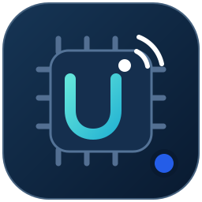

# UWB Board Programmer 2.1.0

**Full desktop workspace: USB Flash, Standalone BLE/GATT, anchor survey,
TDoA processing, recordings and RTLS connection. English / ภาษาไทย.**

## เปิดบนแลปทอปเครื่องใหม่

1. Clone repo นี้ หรือ Pull branch **main**
2. ดับเบิลคลิก **START_HERE.cmd**
3. ตัวเปิดจะตรวจและแตกชุดโปรแกรมให้อัตโนมัติ พร้อมสร้าง Shortcut **UWB Board Programmer - GitHub** ที่ Desktop

ไม่ต้องติดตั้ง Python, pip, SDK หรือคัดลอก firmware เอง ชุดพร้อมใช้งานประมาณ
95 MB อยู่ใน repo แล้ว ไม่ใช้ Git LFS และไม่ต้องดาวน์โหลด runtime เพิ่มตอนเปิด

ใช้ Windows 10/11 **x64** และ .NET Framework 4.8 การรับ BLE ต้องมี BLE adapter
พร้อม driver และเปิด Bluetooth ส่วนการ Flash ต้องมี FTDI driver ให้เห็น COM port
โปรแกรม Flash ทีละบอร์ดได้ และมี firmware สำหรับ A1 Master, A2–A4 Slave,
Tag Setup และ Tag Battery มาให้ครบ

ตั้งค่าพิกัด Anchors และบัญชี RTLS บนเครื่องใหม่ด้วยตนเอง Token, รหัสผ่าน,
log, backup บอร์ด และผลการวัดจะไม่ถูกย้ายผ่าน GitHub โปรแกรมไม่เริ่ม Flash
หรือส่งข้อมูลไป RTLS เองทันทีที่เปิด

คู่มือ: **[START_HERE.md](../START_HERE.md)** ·
[คู่มือหน้าจอทั้งหมด](../docs/INTEGRATED_STANDALONE_GUIDE.v1.th.md) ·
[ผลตรวจชุดพร้อมใช้งาน](../deployment/VALIDATION.v1.md)

## Run on another Windows laptop

Clone/pull **main**, then double-click **START_HERE.cmd**. The repository
includes the application, Python/Qt/scientific/BLE runtime, USB programmer
and firmware. No development environment, Git LFS or first-run runtime download
is required. A Desktop shortcut is created automatically.

A working BLE radio/driver is required for wireless acquisition, and the EVK
FTDI driver is required for USB Flash. Configure your anchor survey and RTLS
sign-in on each new computer. See [START_HERE.md](../START_HERE.md) for local
data locations and profile transfer.

Four-anchor clock synchronization, 3D RF accuracy and live RTLS delivery still
require hardware acceptance tests. The included Standalone BLE firmware is
the project's experimental pilot; portable launch verification is separate
from measurement validation.

The original source revisions, launchers and [original README](../README.md)
are preserved. Use START_HERE or the GitHub Desktop shortcut for this package.
